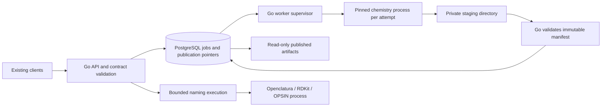

# MolecuLens: Python-to-Go migration analysis

Analysis date: 2026-11-03. Implementation has not started. Read [the two-way agreement](agreement.md) for the decision record and advisor reconciliation.

## Recommendation

Move service ownership to Go: HTTP contracts, admission, PostgreSQL jobs, execution supervision, cache identity, validated artifact publication, and operations. Keep Psi4, RDKit, Openclatura/OPSIN, and initially the NumPy/scikit-image pipeline in isolated chemistry processes. Port selected numerical utilities only after profiling and scientific qualification.

The proposed finish line is a Go-operated service with a small, versioned chemistry adapter, not an immediate Python-free runtime. Calling the Psi4 executable still uses Python internally. Eliminating that runtime, or rewriting Openclatura's naming rules, would be a separate scientific-engine project. There is no two-week deadline; the user clarified that the goal is a two-way agreement with Opus.

Go can simplify concurrency, process ownership and deployment of the service. No measured evidence yet establishes that replacing Python orchestration will materially accelerate the chemistry calculations. Several expensive kernels already execute in native code.

## Evidence and scope

Server: `jakekinchen/moleculens-server`, branch `main`, HEAD `c9fce3c5d9f69212cc65d39e06ae3c18ef74eafb`, plus the existing uncommitted nomenclature work. `source-snapshot.json` records source/configuration/fixture hashes and initial status. Runtime databases, caches and credentials were excluded. Existing implementation changes were preserved; this task produces analysis and disposable probes only.

Inspected the API, schemas, queue/models, worker, all compute modules, configuration, deployment files, tests and naming benchmark. Applied all six code lenses and the state-machine skill. This is a source audit with focused local execution, not production certification or an exhaustive chemistry review.

A narrow consumer check also inspected `/Users/kelly/.openclaw/workspace/projects/moleculens` at HEAD `35dd5f4b4bb174b2005074b8e1e0f16a2702dd5b`: API request transformers and nomenclature upstream calls. This establishes local consumer contracts, not what is deployed. The four selected request/key files are clean; the naming caller is untracked. Their hashes/status are recorded in `consumer-snapshot.json`. Complete application behavior was not audited.

### Executed by Codex

| Check | Result | What it establishes |
| --- | --- | --- |
| `.venv/bin/python -m pytest tests/unit -q -p no:cacheprovider` | 46 passed, one Java availability warning | Existing local unit baseline, including nine nomenclature tests |
| `python -m pytest .../audit_probes.py -q -s -p no:cacheprovider`, launched from `/tmp` | 11 passed | Eleven assertions reproducing current undesirable behavior; **not eleven fixes** |
| `.venv/bin/python -m ruff check src tests scripts --output-format concise` | Passed | Existing source/test/script lint |
| Naming benchmark without OPSIN | 398 cases: 392 named, 6 guarded; 100% supported-name rate and guarded rejection | Naming availability/guard baseline; no structural round-trip proof |
| Three additional audit probes | 3 passed (11 previous probes deselected) | Silently dropped consumer options, fixed-width SDF counts, and element/metal misclassification |
| Installed RDKit probe | `IsMetal` absent; `[Fe]` reports false; `_element_to_number('Au')` returns 6 | Local metal/element handling defect |
| Environment capability check | Psi4 and xTB modules absent; Java unavailable; Docker daemon unavailable; Go absent from PATH | Full stack, native engine and Go runtime checks remain unexecuted |

The unit and audit queue fixtures use temporary SQLite files. The concurrent submission probe exercises the real Python queue path with synchronized lookups; the PostgreSQL race is independently supported by the absence of a uniqueness/serialization mechanism, but was not reproduced on PostgreSQL here. No live service was restarted, deployed, or modified. No Brev resources were created, used, or required.

## What Python currently mediates

| Capability | Current owners | Recommended destination |
| --- | --- | --- |
| Health, cache metrics, three async compute APIs, polling and artifacts | `api/main.py`, `routes.py`, `electrostatics_routes.py`, `conformers_routes.py`, `schemas.py` | Go HTTP boundary with explicit compatibility DTOs and validation |
| Admission, deduplication, lifecycle and result lookup | `db/queue.py` (712 lines), `db/models.py` | Shared Go job domain and explicit PostgreSQL transactions/migrations |
| Work dispatch, scratch and shutdown | `worker/main.py` | Go supervisor with bounded slots and per-attempt processes |
| Orbital energy, wavefunction and cube generation | `compute/psi4_runner.py` | Retain pinned Psi4 adapter; Go invokes it via fixed executable and structured data |
| ETKDG conformers, UFF/MMFF, molecular graph validation | `compute/conformers.py`, parts of `charges.py` | Retain RDKit adapter initially; C++ service/bridge is a later option |
| xTB charge calculation | `charges.py` | Retain initially; direct Go-supervised xTB CLI is a reasonable later slice |
| Molecular surface, potential, mesh encoding and cube parsing | `surface_mesh.py`, `marching_cubes.py`, `electrostatics.py`, `cube_parser.py` | Preserve initially; qualified Go utilities after measurement |
| Names, rule traces, atom mapping, OPSIN verification | `compute/nomenclature.py`, `api/nomenclature_routes.py` | Bounded synchronous Go endpoint over isolated Python/Openclatura/RDKit/Java execution |
| Benchmark and scientific reference fixtures | `nomenclature_benchmark.py`, tests/benchmarks | Retain as independent oracle/evaluator; do not rewrite alongside candidate implementation |

Naming currently runs synchronously in a FastAPI threadpool, outside the persisted job queue. Preserve the public synchronous contract initially; give it a separate bounded execution class so a long orbital job does not consume every naming slot. Python chemistry processes should receive neither database credentials nor authority to publish shared cache entries. Start with per-attempt isolation for heavy computations. Measure conformer/naming startup in the target image before choosing per-attempt execution or a bounded warm pool; pool slots process one job at a time and require attempt-private output, reset/state-leak checks, and kill/replacement after timeout.

## Ranked findings through all six lenses

Priorities describe migration importance. “Confirmed” below means a local reproduction or complete source trace, not a production incident. Location paths are relative to the server unless marked consumer.

### P1: job and publication ownership is not exclusive

**Lenses: invariants, ownership, state transitions.** `db/queue.py:219`, `:419`, `:480`, `:593`, `:640`; `db/models.py:68`; `worker/main.py:87`.

Two submissions can both observe no active job and insert different pending rows for the same key. `FOR UPDATE SKIP LOCKED` protects claiming a particular row; it does not deduplicate submissions. The local concurrent probe creates two active jobs. The indexes are non-unique.

A running job is marked stale from its start time without a heartbeat or proof that its process stopped. A new submission creates a replacement. The old worker can subsequently call `complete_job`, which checks neither current status nor worker/attempt identity. The probe ends with the old job `done`, a stale error still attached, a replacement pending, and an old result installed in the cache. Both attempts also write the same `<cacheKey>` directory. `fail_job` is equally unguarded.

**Smallest coherent correction:** database-enforced active-key uniqueness, serialized per-key cache/admission decisions, explicit attempt tokens/leases, conditional completion/failure, and isolated immutable attempt output. A lock solely in Go memory is insufficient. Do not mix old unfenced workers with new writers to the same cache namespace.

### P1: cache identity omits scientific inputs and trusts a caller override

**Lens: authority.** `db/queue.py:71`, `:384`; `api/electrostatics_routes.py:51`, `:98`; `compute/sdf_parser.py:50`; `compute/electrostatics.py:120`; `api/conformers_routes.py:27`.

The client key replaces server-computed molecular identity. Two different inputs carrying the same key reuse the first job. Intended clients generate recipe-aware keys, but the server does not verify them. The default electrostatics identity hashes symbols/coordinates only, excluding bonds and formal-charge assignments used by Gasteiger. The local probe gives CO and C=O identical geometry hashes but different charges.

Orbital keys round spacing/isovalue to four decimals while computation uses the supplied value. Engine versions, numerical policy and actual fallback engine are absent. An xTB request can cache a Gasteiger result under its requested xTB identity. `chargeModel` discloses the actual method, but does not repair cache validity. Conformer keys contain a caller geometry version but no actual RDKit version or seed policy.

**Correction:** server-owned versioned computation descriptor including operation kind, graph/pose where relevant, charge/spin, normalized effective parameters, a per-adapter result-compatibility version and fallback policy. Keep client keys as optional hints or idempotency keys bound to a server digest; reject conflicting reuse. Initially hashing the full normalized input bytes plus descriptor is safer than prematurely reproducing graph canonicalization in Go. Resolve actual engine policy before lookup; a transient fallback must not populate a strict xTB cache entry. Version fixes instead of silently reusing old results. Exact engine/package/image identity is retained in the manifest; the compatibility-version rule below controls cache reuse across builds.

### P1: polling the wrong endpoint can destroy a valid result association

**Lenses: semantics, authority, failures.** `api/routes.py:172`, `:32`; `api/electrostatics_routes.py:197`; `api/conformers_routes.py:226`; `db/queue.py:270`.

The job getters do not check operation kind. Polling an existing conformer job through the orbital endpoint looks for `result.json`, then invalidates the cache and rewrites the completed conformer as error. This is reproduced with a present `structure.sdf` and completed conformer record.

**Correction:** first-class immutable job kind checked before loading or changing anything; return not found/type mismatch without mutation. Cache validation must target a particular immutable artifact identity, never every job sharing a key after an unrelated read failure.

### P1: incomplete or corrupt output can become scientific success

**Lenses: failures, invariants.** `compute/psi4_runner.py:211`, `:260`, `:289`; `compute/marching_cubes.py:128`; `api/routes.py:235`; `api/electrostatics_routes.py:232`; `db/queue.py:593`.

Missing orbital cube files and processing exceptions are logged and skipped; the runner can still produce a manifest and the worker marks `done`. The result loaders accept `{}` and synthesize empty orbitals or a zero dipole/empty surface with default metadata. This is reproduced for both loaders. The database completion method also accepts missing artifact files. File writes happen directly in the shared destination before the database update, so that transaction cannot make bytes and metadata atomic. Some schema failures occur outside the loaders' read exception handling and instead produce a 500.

**Correction:** require a versioned operation-specific manifest, expected outputs and sizes/digests; validate decoded buffer lengths, finiteness and index bounds. Distinguish “no isosurface at this threshold” from “calculation/meshing failed.” Immutable attempt files become visible only through a guarded committed pointer. A transient I/O failure must remain unavailable/unknown, not rewrite historical computation as failure.

### P1: the local consumer and server disagree on accepted scientific options

**Lens: semantics.** Consumer `src/app/api/orbitals/schema.ts:32`, `src/app/api/conformers/schema.ts:26`; server `api/schemas.py:8`, `:425` and `compute/psi4_runner.py:104`.

The inspected frontend forwards orbital charge, multiplicity and a distinct density isovalue. `ComputeRequest` has none of them, so Pydantic's default extra-field behavior drops them; the runner constructs a neutral/default-spin geometry and uses the orbital isovalue for density. The conformer transformer sends top-level seed, number of conformers, optimize and forceField, while the server expects nested `params`; those fields are ignored and default UFF behavior is used. The frontend also sends snake_case fields to the orbital API. A camelCase-only Go handler would break this real local caller.

When the consumer omits the ESP surface, its cache recipe assumes probe radius 0.9 and padding 1.2, but the server computes with 1.4 and 3.0. The orbital response transformer also reads `meta.grid_spacing_angstrom`, while the server emits `gridSpacingAngstrom`. Freeze both effective defaults and metadata spelling in the consumer fixtures. Normalization must precede cache identity, and unknown-field rejection needs a deliberate compatibility policy rather than an indiscriminate switch that breaks existing callers.

**Correction:** freeze actual producer/consumer fixtures, define supported options, and reject unsupported non-default requests or implement them explicitly. Preserve known aliases and current response envelopes in the compatibility layer. Do not silently claim unsupported chemistry options are honored. This is local source evidence; deployed client usage is unproven.

Activation order matters. The inspected consumer routinely supplies the mismatched density threshold and force field and omits ESP surface settings. Resolve these with coordinated consumer/engine changes before enabling strict rejection. First observe unknown field names against consumer fixtures, then enforce the supported contract. “Default” must refer to the actual effective server recipe, not an unrelated client default.

### P1/P2: chemistry metadata can misstate what was computed

**Lenses: semantics, failures.** `compute/charges.py:84`, `:190`, `:255`, `:273`, `:435`; `api/schemas.py:245`; `worker/main.py:101`; `compute/conformers.py:50`.

The xTB Python adapter never passes multiplicity to the calculator, although the CLI path passes `multiplicity - 1`. Gasteiger fallback takes no requested total charge or multiplicity, and the last-resort simple model explicitly neutralizes its charges. Unknown elements beyond the lookup table become carbon; the local Au probe returns atomic number 6. RDKit's installed periodic table has no `IsMetal`; the exception handler makes the local iron result false and bypasses the intended metal optimization guard.

For Gasteiger, the dipole is computed about coordinate zero but the reported origin is the center of geometry. A Na+ at x=10 Å reports that origin and a dipole above 48 D, where its dipole about the declared origin is zero. Accepting arbitrary potential units does not cause conversion: the worker always returns kcal/mol/e. Input charge consistency, finite charge values, explicit hydrogen policy, dipole sign/origin, and xTB JSON schema need qualified contracts.

**Correction:** validate elements and engine capability; pass spin explicitly; require charge consistency or disclose/reject an unsupported approximation; define dipole reference origin mathematically; restrict units to implemented values. Keep the observed requested/actual method and fallback reason separate. Do not infer scientific correctness from the successful execution of a fallback.

### P1/P2: additional engine semantics need qualification before migration

**Lens: semantics.** `api/schemas.py:67`; `compute/psi4_runner.py:135–162`; `compute/conformers.py:65`, `:145–164`.

Opus's independent, isolated RDKit probe forced embedding failure and observed every atom at `(0,0,0)` in a result labeled `planar_fallback`. Codex inspected the probe and the implementation: failed embedding can clear the existing conformers, and `_ensure_planar_coords` manufactures zero coordinates when none remain. Preserve a valid original 2D conformer or recompute a proper depiction; otherwise fail explicitly. A quality label does not make degenerate geometry usable.

Two Psi4 defects are supported by source and primary documentation, but were not executed in a native Psi4 environment here. The API changes basis names such as `6-31G*` into `6-31gstar`, while Psi4's filename mapping uses `s` for `*`. Keep the logical basis identifier separate from any filename sanitization and verify accepted aliases against the pinned engine. Orbital energies are read using flat irrep-blocked storage with `epsilon.dim()` defaulting to irrep zero, while cube selection uses energy-ordered indices. This can omit or misassociate energies for symmetric molecules and affect the `lumo+1` guard. Qualify symmetric and asymmetric molecules against independently extracted energy/orbital identities. The exact runtime manifestations and supported aliases remain native-integration checks, not results established by the 46 unit tests.

### P2: generated surface positions do not match the sampled field

**Lens: semantics.** `compute/surface_mesh.py:91–108`, `:132–148`.

The field is sampled with `linspace` but marching cubes is given the requested spacing, which generally differs from the actual per-axis interval. The probe with one carbon atom at the origin produces a surface bounding midpoint approximately `[0.025, 0.025, 0.025]` Å. The 200-point cap rescales dimensions and then uses only x spacing for every axis; elongated extents can also truncate small dimensions below two samples.

**Correction:** use the actual three sample intervals, enforce valid dimensions and total voxel/memory budgets, and report effective resolution. Qualify spheres, translated/rotated inputs and anisotropic extents before porting. A generic Go marching-cubes implementation is not automatically equivalent to the current Lewiner algorithm.

### P2: valid unnamed MOL blocks fail the minimal parser

**Lens: semantics.** `compute/sdf_parser.py:95`; `compute/conformers.py:169`.

`content.strip()` removes a valid blank molecule-name header and shifts the counts line. RDKit accepts the generated unnamed block but this parser rejects it in the local probe. That also threatens the conformer-to-orbital/ESP handoff. A further probe shows fixed-width V2000 counts `101100` (101 atoms, 100 bonds) being read as 101100 atoms. The parser also ignores molecular charge/bond records, accepts non-finite coordinate strings and does not support V3000 despite its opening module description.

**Correction:** preserve header line positions, validate finiteness/elements and clearly restrict supported formats. Keep graph-aware validation with RDKit; a small Go pose parser should not accidentally become the authority for chemical identity.

### P1/P2: runtime budgets and automatic recovery are mostly declarative

**Lenses: bounds, ownership, state transitions.** `core/config.py:35`, `:42`; `worker/main.py:31–184`; `db/queue.py:189`, `:540`; `api/conformers_routes.py:170`.

The configured 600-second worker timeout and three retries have no consumers. A signal sets a flag but does not interrupt the running native call. Dead running jobs are not periodically recovered: polling does not recover them and claiming examines pending rows only; recovery requires a same-key submission. Pending jobs older than the same stale threshold can be discarded before they ever run. Failures creating output/scratch directories occur outside the inner job failure handler.

No explicit global queue/admission, result-retention, artifact-byte or input-body budget exists for the main compute APIs. A single worker processes jobs serially; adding workers multiplies native thread/memory demand. Naming has molecule/string limits and unique temporary files, but no application-level execution deadline. Async API handlers perform synchronous database and disk operations. Conformer wait is bounded and monotonic, but each waiting request adds repeated synchronous database reads.

Opus separately ran a controlled ASGI interference probe: a metrics request took approximately 51 ms alone and 506 ms alongside a job poll containing an injected blocking database delay. This illustrates the event-loop blocking mechanism; it is not a production latency measurement or a Go speedup benchmark.

During reconciliation, Opus measured local Python/RDKit startup at 0.24–0.31 seconds versus an approximately 8.2 ms warm conformer computation. Those isolated measurements justify checking startup overhead; they do not establish end-to-end behavior under load or in the target image. Preserve the consumer's bounded conformer wait behavior and 10-second naming deadline, and measure Java/OPSIN startup where verification is enabled.

**Correction:** distinguish queue age from execution lease; supervisor enforces deadlines and process-group termination/drain; one bounded retry policy; periodic lease recovery; explicit admission/backpressure and retention. Choose numeric limits from measured workload and host capacity, not invented performance claims. Treat request disconnect separately from cancellation of a durable accepted job.

### P2: deployment can report healthy without a working service

**Lenses: failures, authority.** `api/routes.py:48`, `scripts/deploy.sh:25`, `.github/workflows/ci.yml`, `.github/workflows/deploy.yml:3`, `docker/Dockerfile.worker:4`.

The health route returns HTTP 200 even with `status=unhealthy`; this is reproduced through the HTTP test client with an injected DB outage. Deployment uses curl success as its gate. CI greps for `healthy`, which also matches `unhealthy`. Worker readiness and representative computation are not checked. Deploy runs independently of CI and fetches current main rather than pinning the event SHA. Docker installs do not use `uv.lock`; the worker base is `psi4/psi4:latest`, so caches may outlive materially different engine versions. Actual GitHub environment protections/production state were not inspected.

**Correction:** separate liveness/readiness, fail readiness status appropriately, pin tested code/images/dependencies, use explicit migration steps, retain rollback images, and require worker capability plus representative canary evidence. Keep metrics protected through the reverse proxy in every supported deployment, including any exposed API port.

### Existing protections to preserve

PostgreSQL row claiming uses `SKIP LOCKED` within a transaction. The conformer wait loop uses a monotonic clock and is capped at ten seconds. Artifact downloads consult a database allowlist and reject traversal in filenames. Mesh compression sets gzip mtime to zero. Nomenclature guards mixtures/metals/size, separates engine and viewer atom domains, uses graph/chirality checks before highlights, labels experimental results, records versions and uses unique OPSIN temp files. Metrics locking is adequate for its explicitly process-local counters. Preserve the distinction between embedded and planar conformer results, while fixing the degenerate fallback described above.

Optional simplifications: eliminate the unused internal `queued` state after compatibility analysis; derive duplicate metadata instead of maintaining competing mutable versions; stop mutating request parameters just to record that a GET emitted a log; separate numerical dependencies from the Go API image. None requires a state-machine framework or a new queue service.

## Explicit state models

### Current persisted job lifecycle

Owner is nominally `JobQueue`, but handlers and workers can trigger unrestricted transitions and file writes independently.

| Current state | Event | Guard | Next state | Effect |
| --- | --- | --- | --- | --- |
| Absent | Submit | No reusable cache/active row found | pending | Insert row; check and insert are not serialized |
| pending | Worker claim | Row lock; younger than stale threshold | running | Set worker, start time, increment attempt |
| pending/running/queued | Same-key submit finds age exceeded | Wall-clock age only | error | Mark old row; create replacement row |
| pending | Claim finds age exceeded | Same age rule | error | Drop pending work |
| Any existing state | Worker complete | Only row existence | done | Update job and cache; files already written |
| Any existing state | Worker failure | Only row existence | error | Store error, including possibly after completion |
| done | Loader cannot load result | Operation kind not verified | error | Delete cache and rewrite all done rows for key |
| running | Worker dies; client only polls | No recovery transition | running forever | No heartbeat/reaper path |

`queued` has no normal producer. There is no cancellation state or API. The presence of retry configuration and attempt count does not implement retries.

### Proposed job model

Use a small domain layer with authoritative SQL transitions. Fields: immutable operation kind/input digest/engine contract; job ID; state; attempt number and unguessable attempt token; worker identity; lease expiry; total deadline; immutable manifest pointer; typed failure. Internal states can remain `pending`, `running`, `done`, `error` for the first version. Preserve external conformer `pending/done/failed` projection. Cancellation can be added only when required, with explicit semantics.

| Current state | Event | Guard | Next state | Effect |
| --- | --- | --- | --- | --- |
| Absent | Submit | Valid bounded descriptor; atomic active-key uniqueness | pending | Insert once; conflicting submit reads winning job |
| pending | Claim | Row lock, supported contract, capacity available | running | Allocate new attempt token and lease |
| running | Heartbeat | Current token and unexpired lease | running | Extend lease within total deadline |
| running | Publish | Current token, valid lease, validated immutable outputs | done | Atomically write manifest pointer and job outcome |
| running | Transient failure/expired lease | Current attempt; retry/deadline budget remains | pending | Revoke token; record attempt reason; retry with new token |
| running | Permanent failure/budget exhausted | Current attempt | error | Store typed terminal failure |
| done/error | Late completion/failure | Token or state mismatch | unchanged | Reject/ignore stale event; never publish its files |
| done | Duplicate acknowledgement retry | Same attempt and manifest digest | done | Return existing committed outcome |
| Any | Poll different operation kind | Kind mismatch | unchanged | Reject without cache mutation |

Use database time for lease decisions. After losing a lease, an old process may still physically run; a token only removes publication authority. The supervisor must kill and reap it where reachable, and partitions must not turn duplicate execution into unbounded resource use. Retry remains at-least-once computation with at-most-one authoritative publication, not an exactly-once claim.

### Artifact availability is independent from computation outcome

| Current state | Event | Guard | Next state | Effect |
| --- | --- | --- | --- | --- |
| Absent | Attempt starts | Owned attempt | staged | Write only in attempt-private directory |
| staged | Compute exits successfully | Manifest/schema/numerical checks pass | validated | Flush and finalize immutable files |
| validated | Publish transaction | Matching current attempt and manifest | available | Commit pointer; readers may resolve it |
| validated | Worker crash or rejected publication | Proven no committed reference and no live attempt | orphan | Garbage collect after grace period and ownership check |
| available | Read transiently fails | Outcome unknown | unavailable | Return typed temporary failure; preserve job/manifest |
| available | Corruption confirmed or retention expiry | Identity-specific validation/retention policy | invalid/expired | Recompute via normal admission; do not overwrite old job history |

The filesystem and PostgreSQL do not share a transaction. The achievable design is immutable durable bytes first, then one database publication pointer. A crash before commit leaves an orphan; an unknown commit acknowledgement is resolved by querying job/attempt/manifest identity. If the database is unavailable, retain the ambiguous output until that query is possible; do not fail or collect possibly committed output merely because the acknowledgement was lost. Atomic rename alone does not fence a stale attempt writing a common destination.

Naming has separate dimensions: request execution (`accepted/running/succeeded/failed/timed out`), OPSIN verification status, and viewer mapping status. Keep `verified`, `opsinStatus`, and `mappingStatus` independent: a successfully named molecule can legitimately have no Java verification or no safe viewer mapping. A future result cache must include the viewer graph/order and verification policy, not just SMILES.

## Architecture and implementation sequence

One Go module is sufficient, with API and worker commands and shared jobs/contracts/artifacts/engine-adapter packages. PostgreSQL remains the durable queue. Avoid introducing Redis, Kubernetes, a workflow library, general plug-in machinery, or an RPC network merely for this migration. A fixed process protocol using bounded JSON input and manifest files fits the current single-box/shared-volume design. Cross-host execution is a later topology decision, not an unstated assumption.

The protocol must name its version, operation kind, job/attempt IDs, effective scientific options, requested and actual engines, input digest, deadlines, output limits and provenance. Failures carry machine-readable codes and retryability. Diagnostics go to bounded stderr/log files, not the result channel. Never interpolate SDF or method strings into Python/Psithon source or a shell command. Launch fixed adapters with validated data files, minimal environment and private scratch directories. A request context is not the lifetime of an already accepted durable job.

| Stage | Work and deliverable | Acceptance gate | Rollback boundary |
| --- | --- | --- | --- |
| 0. Freeze contract and evaluator | Capture current OpenAPI plus actual frontend requests/responses; baseline engine images, workload, graphs/poses, failures and cache policy; resolve known ignored options | Golden fixtures cover all four capabilities, aliases/status/error bodies, nullable/empty values, supported/unsupported chemistry, and existing naming mapping guarantees | No production change |
| 1. Repair prerequisite contracts | Bounded Python fencing, result truth, request identity and scientific fixes; pin the reference and isolate adapters; one versioned SQL migration owner | Defect reproductions become failing-before/passing-after regressions; real PostgreSQL contention and interrupted-writer tests pass; corrected science cases have independent expectations | Retain pinned binaries/data; production rollback targets a fenced compatible build |
| 2. Build Go service boundary | Go HTTP/schema compatibility, read paths and bounded naming bridge; one owner for jobs and manifest publication | Differential request/response tests and consumer tests; no accidental silent defaults; readiness and overload behavior pass | Route back to compatible pinned Python API; do not assume incompatible schema rollback |
| 3. Transfer worker ownership | Go claims/supervises isolated chemistry attempts; leases, process-tree stop/drain, retry budgets, immutable publication and retention | Two-worker duplicate submissions, kill/crash/late result, lost DB acknowledgement, full disk, corrupt artifact, restart and queue saturation tests on PostgreSQL; no unbounded children | Drain old writers and use a distinct queue/cache namespace or proven compatible transition protocol; keep Go jobs routable until terminal |
| 4. Shadow and cut over | Compare bounded sampled traffic in isolated result storage; migrate route families gradually; retain job-ID routing | Chemistry/contract gates plus measured latency, RSS, CPU, queue delay, restart recovery, error rate and rollback drill | Switch new submissions back; continue serving/draining accepted jobs; never enable two incompatible writers on shared output |
| 5. Optional numeric/native port | Profile then port one of compression, cube parsing, potential or mesh transforms; consider direct xTB CLI/C API and RDKit C++ only if justified | Independent decoded-array/numerical/topology comparisons; supported-platform packaging and lifecycle checks | Engine/versioned result namespace allows immediate reversion |

Stage 1 is deliberately bounded. Fix the shared correctness contracts required for safe coexistence; do not redesign the entire chemistry domain before starting Go. If production does not need mixed execution, a fully drained cutover is simpler than a long-lived dual-writer protocol. Old result files can be served under an explicitly legacy identity, but must not be silently relabeled as newly qualified results.

Read-only Go development and contract-fixture work may proceed alongside that hardening. The prerequisite is that Go must not write production jobs or publish artifacts until the authoritative contracts are corrected and tested. Rollback preserves those guards: never drop active-job uniqueness, disable fencing, or restore an old unfenced worker against the new state merely to restore an earlier entrypoint.

The minimum Python hardening is active-key uniqueness with conflict handling, attempt-conditional completion/failure, kind-safe reads, no age-based discarding of pending work, attempt-private output and validated result truth. Build the full lease/reaper/supervisor and publication implementation once in Go. Adopt one versioned SQL migration runner now and remove startup `create_all`; avoid creating two competing migration systems during the language transition.

The default cutover should drain the legacy queue before changing writer ownership. If uninterrupted acceptance requires overlap, use separate queue tables/schema **and** cache roots, then route polling by recorded job origin. A cache-directory prefix alone is insufficient: the existing Python worker claims every pending row without a protocol-version guard. Test old accepted job IDs through the public endpoint after cutover and rollback. Do not delete old artifacts to force correctness; preserve legacy reads and recompute new-version results when their full scientific identity cannot be established.

The drain needs a finite deadline. At a legacy cutoff, quiesce admission/claiming, stop and reap the old process trees, and verify that legacy artifact roots receive no further writes before finalizing affected rows with a typed failure such as `legacy_drain_timeout`. This order matters for the current unfenced worker, which can ignore a database-only revocation. Completion requires zero legacy pending/running jobs and no surviving legacy compute process, with its compatible image retained. Empty database states alone do not establish that execution stopped. Legacy read routes also mutate cache counters/invalidation/log fields, so any fallback to those routes requires compatibility checks even when the new Go route itself is read-only.

Specify the new descriptor serialization once, including defaults, aliases, float normalization, Unicode and ordered versus unordered arrays. Freeze cross-language key vectors. The current Python key encodings differ across operations (`json.dumps` whitespace and four-decimal formatting included), so a naïve Go JSON hash will not reproduce them. Prefer an explicitly new version over pretending byte compatibility. Existing caches may be imported only after descriptor/provenance validation; otherwise serve them as legacy entries within the chosen retention policy.

Initial normalization of molecule text should be conservative and documented, such as line-ending normalization while retaining blank MOL headers. Equivalent serializations may miss a cache hit; scientifically distinct inputs must never be merged. The Go service can compute this byte-based identity synchronously without taking over graph canonicalization. Chemical validity remains an engine responsibility until a separate validated admission interface is introduced.

Preserve immediate invalid-SDF errors with a small Go structural validator: explicitly supported formats, counts/atom-block shape, finite coordinates, known elements and size bounds, checked against independent RDKit fixtures. Parse V2000 counts by fixed columns and preserve blank header lines. Explicitly accept V3000 or reject it with a coded unsupported-format error. Apply validation even when a client cache key is present; closing the current bypass is a deliberate contract correction with its own fixture. The validator does not decide chemical graph identity. More detailed chemical validation remains with the adapter; its failure semantics are covered by route fixtures.

Use a per-adapter result-compatibility version in the descriptor, with exact engine build, dependency versions and image digest in the immutable manifest. Packaging-only rebuilds may retain the compatibility version only when resolved scientific artifacts/environment are unchanged, including the pinned package set, engine base image and native libraries. An unchanged source diff is insufficient. Today's unpinned rebuilds do not qualify; until builds are pinned, use a new compatibility version or keep entries explicitly legacy. Changes to scientific code, engines, dependencies or numerical platform default to a new compatibility version. Retaining one across such changes requires explicit independent qualification; a small passing fixture set alone cannot prove universal compatibility. Any future removal of title/timestamp/SD-data bytes from identity also requires a descriptor version and evidence that no adapter consumes them.

### Acceptance details that must not be lost

- Queue: assert one active logical job per computation key; one accepted publication per attempt; no old failure overwrites a success; no stale worker clobbers current bytes; expired leases recover without a user resubmit.
- Storage: interrupt before/after file finalization and before/after database commit; retry an uncertain acknowledgement; retain usable prior data; never delete referenced or live staged output.
- API: camelCase responses and both currently used input aliases; conformer projection and `waitMs`; 400/422 input failures versus 5xx infrastructure failures; meaningful HTTP readiness; request-body and result-byte limits; explicit unknown scientific options.
- Science: translated/rotated neutral and charged molecules, spin cases, bond-order changes, explicit/implicit hydrogen policy, supported elements, valid blank MOL headers, V3000 policy, density threshold, empty legitimate isosurfaces, missing requested orbitals, distorted/capped grids and NaN rejection.
- Buffers: explicit little-endian float32/uint32, shape/count consistency, finite values, bounds, normals/winding, orbital sign handling. Compare decoded values/geometry; gzip streams and triangulation ordering need not be byte-identical unless the frozen public contract requires it. State tolerances and fixture-specific expectations before implementation.
- Conformers: fixed seed and engine version when determinism is required; atom-order retention; stereochemistry, force-field selection and truthful planar fallback; quality/energy checks rather than arbitrary equality of stochastic coordinates.
- Naming: preserve the 398-case corpus, all guard/mapping tests and the documented OPSIN gate (at least 95% of named supported cases structurally matched); do not equate a round trip with a uniquely preferred IUPAC name. Re-run with real Java.
- Operations: pin dependencies/images and source SHA; migrations must be explicit rather than `create_all`; immutable release identity, health checks and rollback receipts; separate metric sources and measured engine provenance.

## Alternatives and remaining decisions

| Option | Benefit | Cost/risk | Assessment |
| --- | --- | --- | --- |
| Correct the Python implementation only | Smallest initial change; keeps mature engines | Does not achieve Go service ownership | Necessary reference hardening, viable fallback |
| Go service + isolated existing engines | Clear owner for jobs/resources; replaces Python mediation with limited scientific disruption | Python/native runtime still shipped for chemistry | Recommended migration target |
| Go + xTB CLI and RDKit C++ bridge | Can reduce Python in specific paths | ABI/build/lifecycle work; Openclatura and ordinary Psi4 still need Python | Later measured option |
| Entire chemistry stack rewritten in Go | Potential single-language runtime | New quantum chemistry, graph/conformer and naming implementations; large validation burden | Not justified by inspected evidence |

No material need for a state-machine framework was found. Native Go representations plus conditional SQL and process ownership are adequate. Do not promise a speedup, savings, staffing estimate or calendar until workload and engine baselines are measured.

Implementation still needs explicit policy choices for strict versus disclosed fallback engines, treatment of valid planar conformers, charged/open-shell support, tenant/privacy boundaries, resource limits and retention. Safe initial behavior is to preserve supported valid results, make approximation explicit, and reject unsupported scientific requests rather than guess, with coordinated caller compatibility before strict activation. These choices need to be recorded before changing the affected behavior; they do not prevent agreeing on the architecture. Degenerate all-zero fallback coordinates must be fixed regardless of the planar-fallback policy. Until an explicit fallback policy is defined, fallback output must be keyed separately from the strict requested method or left uncached.

## Primary-source feasibility checks

- [Psi4 architecture](https://psicode.org/) describes its C++ computational core and Python driver. [Psithon input documentation](https://psicode.org/psi4manual/master/psithoninput.html) confirms that invoking the executable still interprets Python. A CLI wrapper is isolation, not Python removal.
- [RDKit C++ guide](https://www.rdkit.org/docs/GettingStartedInC%2B%2B.html) documents the C++ alternative and explains why stitching existing native functions together in Python is not inherently a major runtime penalty. This supports retaining the engine while measuring orchestration cost.
- [Openclatura](https://github.com/lamalab-org/openclatura) uses Python/RDKit for naming and optional Java verification. [OPSIN](https://github.com/dan2097/opsin) converts names to structures; it does not replace structure-to-name generation or the decision trace.
- [xTB C API](https://xtb-docs.readthedocs.io/en/latest/capi.html) supports external-language integration with explicit object ownership and Bohr coordinates. [Python binding source](https://xtb-python.readthedocs.io/en/latest/_modules/xtb/interface.html) exposes the `uhf` parameter. Direct integration is feasible but requires numerical/lifecycle qualification.
- [scikit-image marching cubes](https://scikit-image.org/docs/stable/api/skimage.measure.html#skimage.measure.marching_cubes) uses Lewiner by default, with ambiguity handling and topology guarantees. The algorithm choice belongs in parity criteria.
- [RDKit conformer parameters](https://rdkit.org/docs/RDKit_Book.html#conformer-generation) include a seed for reproducibility. Introducing a seed changes the recipe and needs a cache version.
- PostgreSQL documents [queue-oriented `SKIP LOCKED`](https://www.postgresql.org/docs/current/sql-select.html), [partial indexes](https://www.postgresql.org/docs/current/indexes-partial.html), and [`ON CONFLICT`](https://www.postgresql.org/docs/current/sql-insert.html). They provide tools for the proposed ownership boundary; the actual transactions still need concurrency tests.
- [Go `os/exec`](https://pkg.go.dev/os/exec) provides context cancellation, `Cancel` and `WaitDelay`. Killing the direct child does not by itself establish that descendants exited; process-group termination/reaping and staging cleanup require explicit tests on the deployed OS.
- [Psi4 basis filename mapping](https://github.com/psi4/psi4/blob/master/psi4/driver/qcdb/libmintsbasisset.py), [Vector API](https://psicode.org/psi4manual/master/api/psi4.core.Vector.html), [Vector storage implementation](https://github.com/psi4/psi4/blob/master/psi4/src/psi4/libmints/vector.h), and [cubeprop ordering](https://psicode.org/psi4manual/master/cubeprop.html) support the additional engine semantics findings. Runtime qualification must use the pinned deployment version, since these references describe upstream behavior.

## Advisor reconciliation

Opus 5.5 Extra independently reviewed the same dirty local checkout in Claude Desktop session `local_182bddf0-7b25-413f-801e-2340256df144`, then reviewed the Codex analysis and seven concrete proposed decisions. Its [independent report](opus-independent.md), [reconciliation response](opus-response.md) and [final confirmation](opus-final-confirmation.md) are preserved unchanged. Codex accepted its amendments covering admission validation, compatibility versioning, strict-mode activation, one migration owner, finite drain, execution classes and unconditional correction of invalid fallback behavior. Both initially open specification choices were closed in the final exchange; Codex accepts the final clarification on resolved build identity and stopping unfenced legacy processes before finalizing their rows. The [agreement record](agreement.md) identifies final decisions and evidence limits. No material architectural or sequencing disagreement remains. Agreement covers the plan; implementation and release qualification have not passed.
